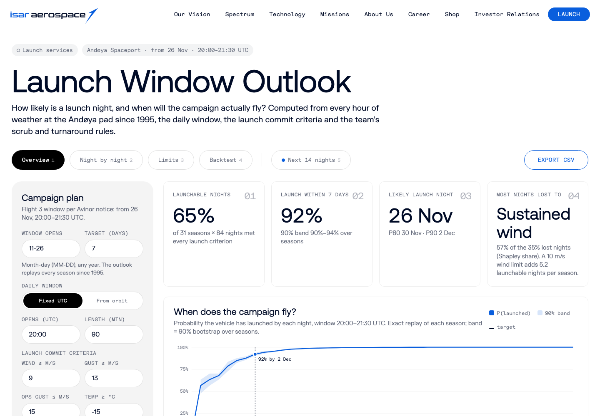

# Launch Window Outlook for Isar Aerospace

**Live demo:** https://mohith26.github.io/isar-launch-window-outlook/

A concept feature for Isar Aerospace's launch services: for any Spectrum campaign at Andøya it answers "how many nights in this window will the weather allow a launch, and when will we actually fly?" It replays every night of the last 31 winters of hourly weather at the pad, scored against launch commit criteria (with a separate ground-operations wind limit for rollout and fuelling), through an exact model of scrubs, turnarounds and crew rest. It shows the launch-date distribution with a confidence band, which criterion costs the most nights (exact Shapley attribution), how much a higher ground-wind limit would buy, a drill-down into every historical night, a backtest against Isar's own public 2025-2026 campaign log, and live odds for the next 14 nights from the 51-member ECMWF ensemble. Flight 3 is a timely test: Avinor's notice opens a window from 26 November 2026 to 17 February 2027, 20:00-21:30 UTC, in the Arctic winter.



## Results (default plan: Flight 3 window, criteria below, 31 winters 1995/96-2025/26)

| Quantity | Value |
|---|---:|
| Nights in the 20:00-21:30 UTC window with launchable weather, 26 Nov + 84 nights | **65.4%** |
| Same window from 1 June | 92.5% |
| Lost nights explained by sustained ground wind (Shapley share) | 57.4% |
| Lost nights explained by pre-launch ops wind / snow and icing / gusts | 19.0% / 11.5% / 10.8% |
| Launchable nights if the ground-wind limit were 10 / 11 m/s instead of 9 | 71.6% / 76.2% (the first +1 m/s adds 5.2 launchable nights per winter) |
| P(launch within 7 nights of opening), 30% non-weather scrub rate, 3-day turnaround | 92.1% (90% band 90-94%) |
| Longest run of consecutive no-go nights in any winter | 11 |
| Default criteria vs Isar's public campaign log (weather-labelled days) | 7 of 7 agree |
| Bias correction, held-out 2020-2025: wind MAE raw ERA5 → corrected | 2.86 → 1.58 m/s |

Every number is recomputed by `node scripts/report.mjs` into `results/results.json`, and the headline values are checked by the tests.

## How it works

1. **Data (real, public).** Hourly ERA5 reanalysis for the Nordmela pad, 1995-2026 (Copernicus/ECMWF via the Open-Meteo archive API), and hourly wind observations at Andøya airport (ENAN, ~8 km away) from NOAA's Integrated Surface Database. `scripts/fetch_era5.py` and `scripts/fetch_isd.py` download and pack them.
2. **Bias correction.** ERA5 averages wind over a ~25 km cell and reads about half of what an anemometer on this coast sees. `src/qmap.js` fits a monthly empirical quantile map from ERA5 to the station (101 quantiles) and `scripts/build.mjs` applies it; fitted on 1995-2019 it cuts wind error on 2020-2025 from 2.86 to 1.58 m/s. The result (`data/andoya.bin`, 4 bytes per hour) has the station's wind distribution and ERA5's complete timeline, including the 2026 campaign days.
3. **Window.** Either a fixed UTC window, or the in-plane window for a sun-synchronous orbit: inclination from the J2 node-rate condition, RAAN from the LTAN and a low-precision solar ephemeris, and the time the pad's sidereal angle puts it in the plane (northbound or southbound pass), solved each day.
4. **Night verdict.** A night is GO if at least one hour inside the window passes the launch criteria (sustained wind, gust, snow/freezing precipitation, thunder, cold) and the gusts during the 8 hours before the window stay under the ground-ops limit.
5. **Campaign model.** Each historical season's real GO/NO-GO sequence goes through an exact dynamic program over (night, consecutive attempts): a GO night is an attempt that launches with probability 1 - p, otherwise the team stands down for the turnaround; after k attempts in a row the crew rests. This gives the exact launch-night distribution per season (weather persistence is kept because real sequences are replayed). Seasons are averaged, with a seeded bootstrap over seasons for the band.
6. **Attribution.** Lost nights are split across criteria with exact Shapley values over all 64 criterion subsets, so the shares add up to the total.
7. **Live.** The next-14-nights view fetches the ECMWF IFS ensemble from Open-Meteo in the browser, applies the same bias correction and criteria to each member, and runs each member through the same campaign model.

Default criteria (assumptions, editable on the page): wind ≤ 9 m/s, gust ≤ 13 m/s in the window; gust ≤ 15 m/s in the 8 h before; no moderate/heavy snow or freezing precipitation; no thunder; temperature ≥ -15 °C. Spectrum's real launch commit criteria are not public; these limits were chosen to agree with Isar's public 2025-2026 log (`src/events.js`).

## Tests

`node --test test/outlook.test.mjs` (15 tests): data coverage; SSO inclination against textbook values; solar ephemeris at the equinoxes and GMST at J2000; **property test** that the computed in-plane time really puts the pad in the orbit plane (300 random orbits/dates) and that `impliedLtan` inverts it; criteria bits; window/ops logic; campaign DP normalisation; **property test** that the exact DP matches a 200,000-run brute-force simulation; Shapley efficiency; quantile-map monotonicity and quantile reproduction; bias correction beating raw ERA5 out of sample; agreement with the public campaign log; the **headline numbers** (65.4%, 92.5%, wind as top cause); monotone wind-limit sweep; deterministic bootstrap. GitHub Actions rebuilds `data/andoya.bin` from the raw inputs, checks it is byte-identical, and runs the tests.

## Honest limitations

- Launch commit criteria are assumptions fitted to a handful of public events (7 weather-labelled days); the backtest is a consistency check, not an independent validation.
- No upper-level winds, wind shear, lightning-field or distant-focusing-overpressure constraints: free hourly upper-air history for the site only goes back to about 2025. The polar night jet over Andøya is real and would lower winter availability further.
- ERA5 hourly values are not pad measurements; quantile mapping fixes the distribution, not every hour. Andøya airport is ~8 km from the pad and sees somewhat different local winds.
- The non-weather scrub rate and turnaround are user inputs. Flight 2's public record (four non-weather stand-downs before liftoff) suggests a qualification campaign is far worse than the 30% default.
- The live view uses raw ensemble frequencies without calibration against past forecasts, and the Open-Meteo ECMWF feed ends at 15 days.
- Only Andøya is modelled; Spaceport Nova Scotia would need its own station record for the bias correction.

## Prior art and what is new here

Weather-availability climatologies are standard practice at established ranges: NASA MSFC's availability tool groups observations by month and hour, the 45th Weather Squadron publishes Lightning Launch Commit Criteria climatologies and per-launch probabilities of violation, and Andøya Spaceport describes long-term weather statistics as part of its mission chronology. What I could not find published for Andøya or for Spectrum customers is the combination here: station-corrected reanalysis at the pad, replay of real night-to-night weather persistence through an exact scrub/turnaround/crew-rest model to get a launch-date distribution, Shapley attribution of lost nights, and a live ensemble view on the same criteria, checked against Isar's own campaign record. I searched isaraerospace.com (launch, Spectrum, mission updates, press), Andøya Space's published weather-criteria talk (AAE, Nov 2025) and the AMS/NASA launch-weather literature.

## Run it

```
python3 scripts/fetch_era5.py      # optional: re-download ERA5 (data/raw/era5_andoya.bin)
python3 scripts/fetch_isd.py       # optional: re-download station data (data/raw/obs_andoya.bin)
node scripts/build.mjs             # bias-correct -> data/andoya.bin, data/qmap.json
node scripts/report.mjs            # -> results/results.json
node --test test/outlook.test.mjs
python3 -m http.server             # then open http://localhost:8000
```

No build step and no dependencies (Node 20+ for scripts and tests). Keyboard: 1-5 views, arrow keys move between nights, Enter opens, Esc closes, S saves the plan, E exports CSV.

Unofficial concept demo by Mohith Gajjela. Not affiliated with Isar Aerospace. Data: ERA5 (Copernicus Climate Change Service) via Open-Meteo (CC BY 4.0); NOAA ISD (public domain); ECMWF ensemble via Open-Meteo.
